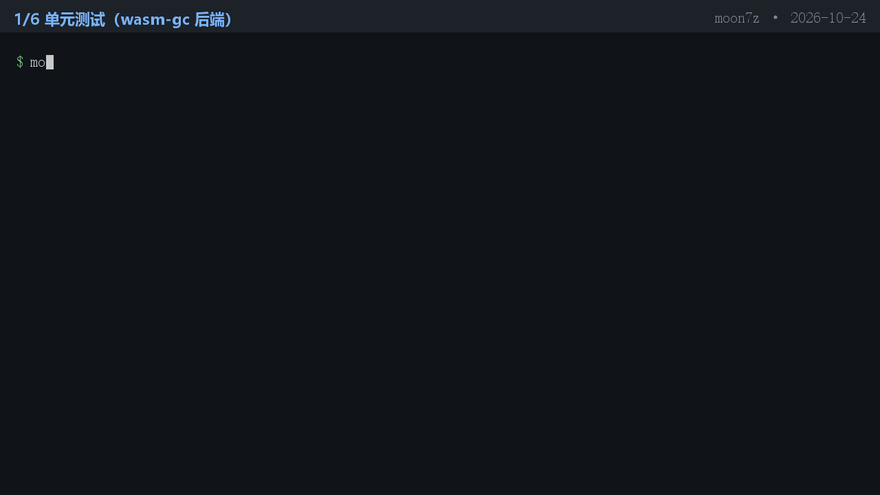

# moon7z

纯 MoonBit 实现的 **7z 归档只读解包库**（`.7z` / 7-Zip 容器），目标后端 `wasm-gc`。
**库本体零第三方依赖**（只用 MoonBit 标准库）；只有可运行的命令行示例 `cmd/main` 用
`moonbitlang/x` 读文件。

> 状态：`0.1.0` 开发中。已实现起始头校验、明文头解析、**编码头（LZMA/LZMA2 压缩的头）解码**、
> 条目表与**端到端解包**（COPY / LZMA1 / LZMA2）。
> 也就是说：`bsdtar` 或 7-Zip 生成的**普通 7z**（明文头或 LZMA/LZMA2 压缩头）都可以列目录并解出内容。

| 能力 | 状态 |
|---|---|
| 起始头 / 两处 CRC-32 / 边界校验 | ✅ |
| 明文头（kHeader）：属性树、Folder/Coder、SubStreams、文件表 | ✅ |
| 编码头（kEncodedHeader）：用 LZMA1/LZMA2 解出被压缩的头 | ✅ |
| 解包 coder：COPY(0x0) / LZMA1(0x030101) / LZMA2(0x21) | ✅ |
| 目录、空文件、非 ASCII（UTF-16）文件名、Solid 块、多子流 | ✅ |
| 过滤器链（BCJ/Delta 等前置 coder）、AES 加密、分卷、BCJ2、PPMd/BZip2/Deflate | ❌ 明确不做（报 `Unsupported`） |

## 为什么做这个

MoonBit 生态里归档格式已经很全：`zip`、`tar`、`gzip/deflate`、`brotli`、`xz/lzma` 都有纯
MoonBit 实现，**唯独 7z 没有**——而 7z 是 Windows 上最常见的分发格式。
已有的相邻项目层次不同：

| 包 | 覆盖范围 |
|---|---|
| `TWISTY2Ynb/moonmspack` | CAB / CHM / MSZIP / LZX（Microsoft 容器族） |
| `aurora0x27/lzma-mbt`、`lin2077-zeming/moonxz` | `.xz` / `.lzma` 单流格式的编解码 |
| **moon7z（本项目）** | **7z 归档容器**：属性树、Folder/Coder 图、文件表、Solid 块与解包 |

## 安装与使用

```bash
moon add Sxy11112/moon7z      # 作为依赖加入你的 MoonBit 项目
```

最小使用样例（不读文件，直接给字节）：

```moonbit
fn demo(bytes : Bytes) -> Unit raise {
  let z = @moon7z.SevenZ::open(bytes)
  for e in z.entries() {
    println(e.name + " " + e.size.to_string())   // 目录的 size 为 0，is_dir 为 true
  }
  let files = z.extract_all()                    // [ArchiveFile]：name + data
  println(files.length().to_string() + " 个文件")
}
```

## 明确不做（工程边界）

- 只读：不创建、不修改、不追加 7z 归档；
- 不支持 AES 加密、分卷（multi-volume）、BCJ2；
- 不支持过滤器链（BCJ / Delta 等前置 coder，可执行文件常见）——遇到时报 `Unsupported`；
- 不支持 PPMd / BZip2 / Deflate 等其它 coder；
- 不支持 RAR / ACE 等其他归档格式。

## 演示



（完整 30 秒 MP4：[docs/demo.mp4](docs/demo.mp4)。用 `python tools/make_demo.py` 可重新生成：
脚本现场执行 `moon test`、`cmd/main list`、`cmd/main extract`、`tar -tvf` 对拍、
`tools/check_compat.py` 汇总，并把**真实输出**渲染成视频。）

## 当前可用的 API

```moonbit
let z = @moon7z.SevenZ::open(bytes)   // 校验签名、版本、两处 CRC-32 与偏移边界

// F1：起始头
let sh = z.start_header()
println(sh.minor)                     // 归档次版本号（bsdtar 写 0.3，官方写 0.4）
println(sh.absolute_offset())         // 头数据库在文件中的绝对起点

// 条目表与流信息
let entries = z.entries()             // [Entry]：name / size / crc / is_dir
let streams = z.streams()             // 打包位置与大小、Folder/coder 链、子流大小与 CRC

// 解包（COPY / LZMA1 / LZMA2）
let files = z.extract_all()           // [ArchiveFile]：目录跳过，空文件为空 Bytes
let one = z.extract("a.txt")          // 按名字取单个文件
```

所有输入都当作外部不可信数据：截断、签名不符、版本不支持、CRC 不符、偏移越界、
属性树非法、压缩码流损坏都返回结构化的 `SevenZError`（含 `LzmaCorrupt`），不会 panic。

### 两个实测得到的格式细节

**kName 块的两种形态**：按格式说明名字块是 UTF-16LE、每名以 `0x0000` 结束。但实测
**libarchive（bsdtar）写出的块首多一个 `0x00` 字节**，而且 libarchive 只接受这种形态
（把该字节去掉后 `tar -tf` 报 `Damaged`，见 `tools/gen_fixtures.py` 的构造注释）。
本实现两种形态都支持：判据不是"名字个数是否等于 numFiles"（两种形态都能凑出同样的个数，
libarchive 形态会解出乱码名字），而是**整个块必须被精确消费完**，只有满足该条件的偏移才被接受。

**LZMA2 的 LZMA 块头**是 `ctrl, unpack-1(2B 大端), packed-1(2B 大端), [ctrl>=0xC0 时 1B props]`，
控制字节语义为：`0x80-0x9F` 无复位；`0xA0-0xBF` state 复位（无 props）；`0xC0-0xDF`
state 复位 + props；`0xE0-0xFF` 再叠加字典复位；`0x01/0x02` 为未压缩块。
另外 LZMA1 裸流的尾部可能有编码器 flush 但解码器用不到的字节（实测某向量只消费 29/34），
因此判据是"是否产出声明的 `unpack_size`"，而不是"是否消费完所有输入"。

## 验证方式

- 真实语料由 `bsdtar`（Windows 自带 `tar.exe` / libarchive）生成：
  `python tools/gen_fixtures.py`（默认保留已提交的语料，`--force` 才重生成，`--only <名字>` 只处理一个）；
- 期望值来自**独立来源**：`tar -tvf` 的列目录结果、`tar -xf` 解出的文件字节
  （生成脚本会在生成时用 libarchive 解包并与写入内容逐字节比对）、Python `zlib.crc32` 算出的内容 CRC；
- CRC-32 用标准检查值（zlib）做已知答案比对；
- 每个判据都做变异测试（改坏实现必须变红，并记录能抓到什么）。

语料（`tools/corpus/`）：

| 语料 | 压缩 | 说明 |
|---|---|---|
| `two_text.7z` / `two_text_lzma1/2.7z` | LZMA/LZMA2 | 编码头（0x17），供 F4/F5 |
| `two_text_copy.7z` | copy | 明文头，多文件 |
| `one_file_copy.7z` / `tree_copy.7z` | copy | 单文件；含目录条目（kEmptyStream） |
| `empty_file_copy.7z` | copy | 含 0 字节文件（kEmptyStream + kEmptyFile，非目录） |
| `nested_copy.7z` | copy | 嵌套目录 + 非 ASCII（UTF-16）文件名 |
| `big_copy.7z` | copy | 20 KB 文件（较大 packed 数据的切片与 CRC） |
| `minimal_two_copy.7z` | copy | 手工构造的最小两文件归档（libarchive 复核可读） |

## 命令行示例（可运行）

```bash
# 列目录：每行 "<名字>\t<大小>\t<CRC32>"（目录的 size/crc 为 "-"）
moon run --target js cmd/main -- list tools/corpus/two_text.7z

# 解包到目录（自动创建子目录）
moon run --target js cmd/main -- extract tools/corpus/tree_copy.7z /tmp/out
```

失败时输出 `UNSUPPORTED\t<原因>` 或 `ERROR\t<原因>`（跨后端行为一致，便于脚本判断）。

## 工程化

- CI（`.github/workflows/ci.yml`）：`moon fmt --check`、`moon check --deny-warn`、`moon build`、
  `moon test`（wasm-gc + js），随后安装 `libarchive-tools` 与 `p7zip-full`，
  跑 `python3 tools/check_compat.py --full-extract` 做**第三方对拍**：
  列目录（名字 + 大小）、内容 CRC、以及解包后逐文件 SHA-256。
- 本地（Windows，只有 `tar.exe`）可跑默认模式：
  `python tools/check_compat.py --runner "moon run --target js cmd/main --" --oracle tar --min-ok 10`
- 对拍脚本对本实现明确报 `UNSUPPORTED` 的归档记为 SKIP；临时目录**必须放在 moon 模块之外**
  （moon 的包发现会扫描模块内所有目录，残留临时目录会让 `moon run/check` 直接失败）。

## 许可

Apache-2.0，见 [LICENSE](LICENSE)。
